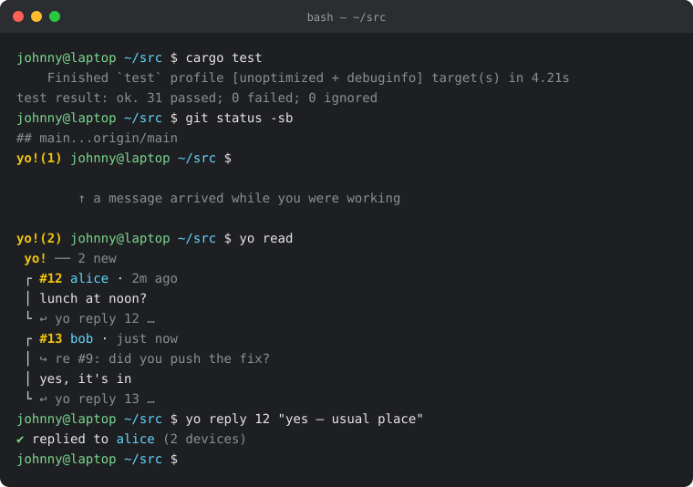

# yo!

```text
 _   _  ___   _
| | | |/ _ \ | |
| |_| | (_) ||_|
 \__, |\___/ (_)
 |___/
```

**Private, end-to-end encrypted messages from your terminal.**

```console
$ yo alice "lunch at noon?"
✔ sent to alice (2 devices)

$ yo read
 yo! ── 1 new
 ┌ #12 alice · 2m ago
 │ sure — the usual place?
 └ ↩ yo reply 12 …

$ yo reply 12 "yes, see you there"
```

- **End-to-end encrypted** with the Olm Double Ratchet (via the audited
  [`vodozemac`](https://github.com/matrix-org/vodozemac)). The relay server
  only ever handles ciphertext.
- **Encrypted in transit** (TLS 1.3, mutual authentication, pinned server
  key), **on the server**, and **on your disk** (Argon2id + XChaCha20-Poly1305).
- **A fresh key for every contact.** Conversations share nothing
  cryptographically.
- **`yo burn alice`** destroys one conversation on both sides and leaves the
  rest alone.
- **Easy key exchange:** `yo add bob` shows `48213-crossbow-marble-tundra`; read
  it to bob over the phone. SPAKE2 means not even the server can intercept it.
- **Admin from your client:** `yo admin token` mints an invitation for a new
  person over the same mutual-TLS connection — no SSH, no web login.
- **Optional status page:** a read-only HTTPS page with a green/yellow/red
  LED, deployed version and uptime, fed by a local socket.
- **Prompt indicator:** `yo!(3)` in bash, zsh, fish or PowerShell.

  
- **Multiple devices**, on Linux, macOS and Windows.

## Quick start

```sh
cargo install --git https://github.com/jsprada/yo yo-cli   # the `yo` client
cargo build --release -p yo-server                          # the server (Linux)

# server
yo-server --dir ./srv init --host yo.example.com
yo-server --dir ./srv token create --admin   # your own token; later tokens come from `yo admin token`
yo-server --dir ./srv run

# each person
yo init --server yo.example.com:7443 --pin sha256:… --token …
yo add bob                     # bob runs: yo add alice <code>
yo bob "hey!"
yo read
yo daemon install              # notifier + passphrase cache
yo prompt bash >> ~/.bashrc    # prompt indicator
```

## Documentation

The full documentation is published at **<https://jsprada.github.io/yo/>**
(rebuilt from `docs/` on every push to `main`). The same pages read fine on
GitHub, starting from [`docs/src/SUMMARY.md`](docs/src/SUMMARY.md), or
locally with [mdBook](https://rust-lang.github.io/mdBook/):

```sh
cargo install mdbook
mdbook serve docs        # http://localhost:3000
```

- [Server setup](docs/src/server/setup.md) · [First deployment checklist](docs/src/server/deploy.md) · [Deployment runbook](DEPLOYMENT.md)
- [Install & set up a client](docs/src/client/install.md)
- [Adding contacts](docs/src/client/contacts.md)
- [Messaging](docs/src/client/messaging.md) · [Prompt indicator](docs/src/client/prompt.md) · [Daemon](docs/src/client/daemon.md) · [Devices](docs/src/client/devices.md) · [Burn](docs/src/client/burn.md)
- [Command reference](docs/src/reference/commands.md) · [Security model](docs/src/reference/security.md) · [Security review](SECURITY_REVIEW.md) · [Remediation log](SECURITY_REMEDIATION.md) · [Protocol](docs/src/reference/protocol.md)

## Repository layout

| Crate | |
|---|---|
| `crates/yo-proto` | wire types, framing, padding, wordlist, TLS helpers |
| `crates/yo-crypto` | Olm sessions, per-contact identity keys, SPAKE2 invites, signing, sealing |
| `crates/yo-store` | encrypted local storage |
| `crates/yo-cli` | the `yo` client (engine, agent, daemon, CLI) |
| `crates/yo-server` | the `yo-server` relay |
| `crates/yo-status` | optional read-only HTTPS status page for a server |

```sh
cargo test --workspace   # unit tests + end-to-end tests against a real server
```

## Status

New software that hasn't been independently audited. Read the
[security model](docs/src/reference/security.md) for what it does and doesn't
protect against.

## License

MIT OR Apache-2.0
